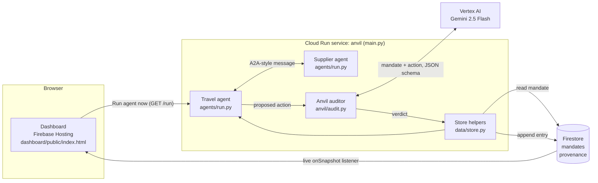
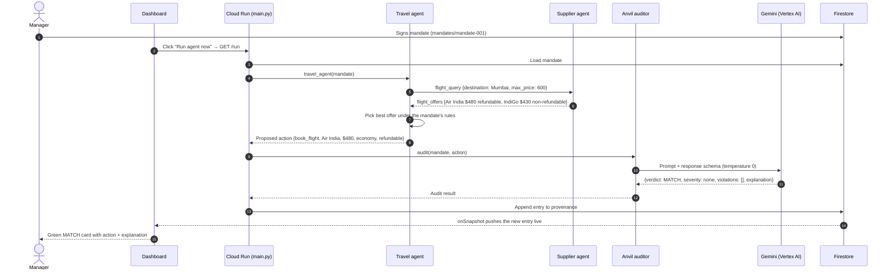

# Anvil — Day 1 Kickoff Guide

**Project:** Anvil — governance layer for autonomous spending agents (Travel & Expense)
**Goal of Day 1:** Get the thinnest possible end-to-end slice running **and deployed** before building any real features.

> **The one rule that wins hackathons:** build a tiny version that touches every layer and deploy it on Day 1.
> Do NOT build components separately for 3 days and integrate at the end — that's how teams fail. Get the pipes connected first, then thicken each piece.

---

## PART 1 — Hour 0 (do this together, before any feature code) ≈ 2 hours

Work through these in order. After each step there's a **✅ Success check** — don't move on until it passes.

### Step 1 — Install the tools (everyone, 20 min)
Install these on each person's laptop:

1. **Python 3.11+** → https://www.python.org/downloads/ (tick "Add Python to PATH" during install on Windows)
2. **Google Cloud CLI (`gcloud`)** → https://cloud.google.com/sdk/docs/install
3. **Node.js (LTS)** → https://nodejs.org (needed for the Firebase CLI)
4. **Git** → https://git-scm.com/downloads
5. **VS Code** (or any editor) → https://code.visualstudio.com

**✅ Success check** — open a terminal (PowerShell on Windows) and run each; each should print a version:
```
python --version
gcloud --version
node --version
git --version
```

---

### Step 2 — Create ONE Google Cloud project (one person does this, 15 min)
Only **one** teammate creates the project; everyone else gets added to it.

1. Go to https://console.cloud.google.com
2. Top bar → project dropdown → **New Project** → name it `anvil-hackathon` → **Create**.
3. **Enable billing:** left menu → **Billing** → link a billing account. (New Google Cloud accounts get free credits — enough for a hackathon.)
4. **Add your teammates:** left menu → **IAM & Admin → IAM** → **Grant Access** → paste each teammate's Google email → give role **Editor** → Save.

**✅ Success check:** every teammate can open https://console.cloud.google.com and see the `anvil-hackathon` project in their project list.

---

### Step 3 — Log in and point gcloud at the project (everyone, 5 min)
In your terminal:
```
gcloud auth login
gcloud config set project anvil-hackathon
gcloud auth application-default login
```
> Replace `anvil-hackathon` with the real Project **ID** (find it in the console, under the project name — it may have a number suffix like `anvil-hackathon-4821`).

**✅ Success check:**
```
gcloud config get-value project
```
prints your project ID.

---

### Step 4 — Turn on the Google services we need (one person, 5 min)
Run this one command — it enables everything at once:
```
gcloud services enable aiplatform.googleapis.com run.googleapis.com firestore.googleapis.com cloudbuild.googleapis.com
```

**✅ Success check:** the command finishes with `Operation finished successfully` (no red errors).

---

### Step 5 — Get a Gemini API key the FAST way (everyone, 5 min)
The quickest path to a working Gemini call is Google AI Studio:

1. Go to https://aistudio.google.com
2. Click **Get API key** → **Create API key** → copy it.
3. In the model list, note the name of a **Flash** model (fast + cheap) — you'll paste it in the code. Copy the exact model name shown there.

> Keep the key private. Don't commit it to GitHub. (Later you can switch to Vertex AI for the "official GCP" story — but start here so you're not blocked.)

**✅ Success check:** make a test file `test_gemini.py`:
```python
from google import genai
client = genai.Client(api_key="PASTE_YOUR_KEY_HERE")
resp = client.models.generate_content(
    model="PASTE_MODEL_NAME_FROM_AI_STUDIO",   # e.g. a Gemini Flash model
    contents="Say hello in one short sentence."
)
print(resp.text)
```
Install the SDK and run it:
```
pip install google-genai
python test_gemini.py
```
It should print a sentence from Gemini. **If this works, your AI layer is unblocked.**

---

### Step 6 — Deploy a "hello world" to Cloud Run (one person, 20 min) ← most important step
This proves deployment works NOW, not on Friday. Make a folder `hello/` with 2 files:

**`hello/main.py`**
```python
import os
from flask import Flask
app = Flask(__name__)

@app.route("/")
def home():
    return "Anvil is deployed and alive."

if __name__ == "__main__":
    app.run(host="0.0.0.0", port=int(os.environ.get("PORT", 8080)))
```

**`hello/requirements.txt`**
```
flask
gunicorn
```

Then from inside the `hello/` folder, deploy (Cloud Run builds the container for you — no Docker knowledge needed):
```
gcloud run deploy anvil-hello --source . --region us-central1 --allow-unauthenticated
```
Answer `y` to any prompts. After ~2–3 min it prints a **Service URL**.

**✅ Success check:** open that URL in a browser → you see "Anvil is deployed and alive." 🎉
**If this step is painful, that's the point — you found the problem on Day 1, not Day 5.**

---

### Step 7 — Set up the shared GitHub repo (one person, 10 min)
1. Create a repo at https://github.com/new → name it `anvil` → add teammates as collaborators (Settings → Collaborators).
2. Everyone clones it:
```
git clone https://github.com/YOUR-TEAM/anvil.git
```
3. Add a `.gitignore` with at least:
```
__pycache__/
*.pyc
.env
*-key.json
```
> **Never commit API keys.** Put secrets in a local `.env` file (which `.gitignore` excludes).

**✅ Success check:** everyone can `git pull` and `git push` to the repo.

---

### Hour 0 is DONE when all of these are true
- [ ] Everyone has the tools installed (Step 1)
- [ ] One GCP project exists, billing on, all teammates added (Step 2)
- [ ] Everyone is logged into gcloud on the right project (Step 3)
- [ ] The 4 Google services are enabled (Step 4)
- [ ] Everyone has made one successful Gemini call (Step 5)
- [ ] A "hello world" is live on a Cloud Run URL (Step 6)
- [ ] Everyone can push/pull the GitHub repo (Step 7)

---

## PART 2 — Day 1 Goal: the "Walking Skeleton"

Build the thinnest slice that touches **every layer**, end to end:

> Manager signs a trivial **mandate** → the travel agent proposes **one** action → the **Gemini auditor** returns `MATCH` → write the result to **Firestore** → show it on a **one-page dashboard** → all of it **deployed on Cloud Run**.

**No real features yet.** No drift detection, no multi-agent negotiation, no self-correction. Just prove the pipes connect. Once this works, every later feature is an *upgrade to a working system* instead of a risky new integration.

### Suggested repo structure
```
anvil/
├── agents/        # travel agent + supplier agent (Owner A)
├── anvil/         # the auditor / guard (Owner B)
├── data/          # Firestore schema, mock inventory, mandates (Owner C)
├── dashboard/     # Firebase-hosted UI (Owner D)
├── hello/         # the Cloud Run test from Hour 0
└── README.md
```

---

## PART 3 — Day 1 tasks by owner (work in parallel)

### Owner A — Agents & A2A
- [ ] Create a **travel agent** (Gemini-powered) and a **supplier agent** as two small services.
- [ ] Make them exchange **one** A2A-style message: travel agent asks "flight options to Mumbai under $X?", supplier agent replies with a hard-coded option.
- [ ] Output a single "proposed action" object (e.g. `{ "type": "book_flight", "vendor": "...", "price": ..., "class": "economy" }`).
- **Definition of done:** running `python agents/run.py` prints one proposed action from the agent conversation.

### Owner B — Anvil auditor (the riskiest piece — start first)
- [ ] Write the **drift-auditor function**: input = a mandate + a proposed action; output = structured JSON `{ "verdict": "MATCH" | "REVIEW" | "DRIFT", "severity": "none" | "low" | "high", "violations": [...], "explanation": "..." }`.
  - **Three verdicts, not two** — this is a deliberate upgrade:
    - `MATCH` → action honors the mandate → allow it through.
    - `REVIEW` → not forbidden, but exceeds what the human authorized (e.g. price over cap, non-refundable instead of refundable) → **escalate for one-tap human re-consent** (maps to AP2 re-consent).
    - `DRIFT` → forbidden / unauthorized action → block it.
- [ ] For Day 1, make it return `MATCH` on a clearly-compliant hard-coded example, using Gemini with **structured/JSON output** so parsing never breaks.
- [ ] **Stub the baseline** (just a skeleton today — fill it Day 2): a dumb `rules_baseline(mandate, action)` that does only a budget check + a supplier allowlist. You'll run the *same* test cases through both Anvil and this baseline to prove Anvil catches semantic violations the rules miss — **with zero false blocks**. This comparison is your strongest Technical-Merit evidence; scaffold it now so it's ready.
- **Definition of done:** running `python anvil/audit.py` prints valid JSON with `"verdict": "MATCH"`, and `rules_baseline()` exists and returns a pass/fail on the same inputs.

### Owner C — Data, mandates & provenance
- [ ] Define the **Firestore schema**: a `mandates` collection and a `provenance` (audit log) collection.
- [ ] Write one mandate document by hand (economy, preferred airlines, ≤ $300/night, deadline).
- [ ] Write a small helper to **append an entry** to the provenance log.
- **Definition of done:** a mandate exists in Firestore and you can write + read back one provenance entry.

### Owner D — UI, deploy & pipeline
- [ ] Set up **Firebase Hosting** for a one-page dashboard: `firebase init hosting` in the repo.
- [ ] Make the page **read the provenance log** from Firestore and list entries (even just raw text for now).
- [ ] Own the **deploy pipeline** — make sure the team's service deploys to Cloud Run with the same command pattern from Hour 0 Step 6.
- **Definition of done:** a live dashboard URL shows the provenance entry Owner C wrote.

---

## Day 1 is DONE when...
You can tell this story on screen, end to end, deployed:

> "The manager signed this mandate. The agent proposed this action. Anvil checked it and said MATCH. Here it is, logged, showing live on our dashboard — all running on Google Cloud."

That's the skeleton. **Days 2–5 (in the project brief) add the muscle:** the real booking flow, the intent-drift detection, the self-correction loop, the full multi-agent trip, and the polish.

---

## PART 4 — What we actually built (Day 1 as-built reference)

> **Snapshot of the end of Day 1.** The system has grown since (A2A Agent Cards, hotel/transport agents, signed Intent/Cart Mandates, self-correction, hash-chained log, new dashboard). For the current architecture and run instructions see `README.md`.

**Live URLs**
- Dashboard (Firebase Hosting): https://dazzling-lodge-511607-m0.web.app
- Pipeline service (Cloud Run): https://anvil-733520529727.us-central1.run.app (`/run` triggers the chain, `/api/provenance` returns the log)
- Repo: https://github.com/Adhi1402/anvil

### 4.1 Architecture



| Layer | Technology | Code |
|---|---|---|
| UI | Firebase Hosting, Firestore web SDK (live listener) | `dashboard/public/index.html` |
| Orchestration / API | Flask on Cloud Run (gunicorn) | `main.py`, `Procfile` |
| Agents | Plain Python, A2A-style messages | `agents/run.py` |
| Auditor | Gemini 2.5 Flash on Vertex AI, structured JSON output | `anvil/audit.py` |
| Data | Firestore (Native mode): `mandates`, `provenance` | `data/store.py` |
| Security | Firestore rules: public read, no client writes; backend writes via service account | `firestore.rules` |

### 4.2 End-to-end flow



### 4.3 What each component does

**Mandate (data, Owner C)** — the manager's authorization, stored in Firestore `mandates/mandate-001` as a signed **AP2 Intent Mandate** (added Day 2): `{type: "IntentMandate", mandateId, user, constraints, issuedAt, expiresAt, nonce, signature}`. The signature is an HMAC-SHA256 over the canonical JSON, and `/run` refuses (HTTP 403) if it doesn't verify. `constraints` holds the terms: destination (Mumbai), `flight_class` (economy), `max_flight_price_usd` (600), `preferred_airlines` (Air India, IndiGo), `allowed_suppliers` (`supplier-agent-1`), `max_hotel_per_night_usd` (300), `refundable_required` (true), `book_by` (2026-11-01). The agents and the auditor work from `constraints`; it is the single source of truth the auditor judges against.

**Travel agent (Owner A)** — acts on the traveler's behalf. It reads the mandate, sends the supplier agent a `flight_query` with the destination and price cap, receives the offers, and picks one. Its ranking: refundable fares first (when the mandate requires them), then preferred airlines, then lowest price. It outputs exactly one *proposed action*:
`{type: book_flight, supplier, vendor, price, class, refundable, destination}`. It does **not** book anything — it only proposes, and Anvil decides whether the proposal may proceed.

**Supplier agent (Owner A)** — plays the airline/vendor side. It receives the `flight_query`, filters its hard-coded inventory (Air India $480 refundable, IndiGo $430 non-refundable) by destination and price cap, and replies with a `flight_offers` message. Each message is an envelope `{id, from, to, type, body}`, which is the A2A-style contract we can later swap for real A2A.

**Anvil auditor (Owner B)** — the governance layer and the core of the project. It takes the mandate plus the proposed action and asks Gemini to judge whether the action honors the mandate's *letter and intent*, returning schema-constrained JSON so parsing never breaks:
- `MATCH` (severity none): the action honors the mandate, so allow it.
- `REVIEW` (severity low): not forbidden but beyond what the human authorized (e.g. over the price cap, non-refundable when refundable is required), so escalate for one-tap re-consent.
- `DRIFT` (severity high): forbidden or unauthorized (wrong destination or supplier), so block it.

It also contains `rules_baseline()`, a deliberately dumb budget-plus-allowlist check kept for the Day 2 comparison: the same test cases run through both, to show Anvil catches semantic violations the rules miss.

**Provenance log (Owner C)** — an append-only audit trail in Firestore `provenance`. Each entry records timestamp, mandate id, the proposed action, verdict, severity, violations, and Gemini's explanation, plus `prev_hash` and `hash` (Day 2) so the log is a tamper-evident hash chain. The chain head and `verify_chain()` follow the hash links, not timestamps, so clock differences between laptops and Cloud Run can't fork it. This is the "who authorized what, and what was decided" record.

**Pipeline service (`main.py`, Owner D)** — a Flask app on Cloud Run that wires the chain together. `/run` runs mandate → agents → auditor → provenance; `/api/provenance` returns the log; `/` serves a simple server-rendered copy of the log.

**Dashboard (Owner D)** — a static page on Firebase Hosting that subscribes to the `provenance` collection with a live listener, so new verdicts appear without a refresh, color-coded green / amber / red. Its **Run agent now** button calls the Cloud Run `/run` endpoint.

### 4.4 Where the build differs from the plan above

- **Gemini access:** the Gemini call uses **Vertex AI** with the gcloud login instead of an AI Studio key (the AI Studio key's prepaid credits were depleted). No API key is needed; `.env` is not required.
- **Agents are in-process, not two services:** the travel and supplier agents are Python functions in one Cloud Run service, exchanging real A2A-style message objects. Splitting them into separate services is a later upgrade.
- **Travel agent is rule-based today:** it ranks offers deterministically rather than calling Gemini. Only the auditor uses Gemini on Day 1.
- **Two dashboards:** the Firebase page is the official one; the Cloud Run `/` page is a server-rendered fallback.
- **Public demo access:** the Cloud Run service is unauthenticated and the Firestore rules allow public reads. Lock both down before the final demo.
- **Cloud Run build permissions:** the first deploy failed until the default Compute service account was given Cloud Build, Storage, Artifact Registry and Logging roles. It also needs `roles/datastore.user` and `roles/aiplatform.user` at runtime.

### 4.5 Run it yourself

```
python -m agents.run        # prints one proposed action
python -m anvil.audit       # prints MATCH JSON + rules_baseline result
python main.py              # local server; open http://localhost:8080/run
gcloud run deploy anvil --source . --region us-central1 --allow-unauthenticated
firebase deploy --only hosting,firestore
```

---

### If you get stuck
- **gcloud auth errors:** re-run `gcloud auth login` and `gcloud auth application-default login`.
- **Cloud Run deploy fails:** check the API is enabled (Step 4) and you're in the right region (`us-central1`).
- **Firestore "permission denied":** make sure Firestore is created in the console once (Native mode) and your login has Editor role.
- **Gemini call fails:** confirm the model name is copied exactly from AI Studio and the key is pasted correctly.

Keep the scope tiny today. A working skeleton beats three half-built features every time.
