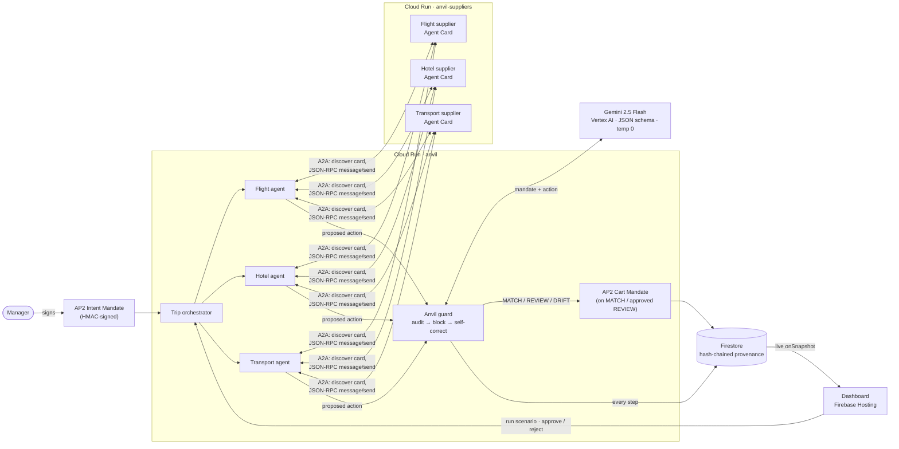

# ANVIL — governance for autonomous spending agents

AI agents already book travel and spend money on a company's behalf, but nothing checks that they stayed inside what a human actually approved. **Anvil** is the layer that does. A manager signs a **mandate**; a team of agents plans a trip over **A2A**; every proposed action is audited by **Gemini** against the *intent* of that mandate (not just its numbers) and comes back `MATCH` (allow), `REVIEW` (escalate for one-tap human re-consent) or `DRIFT` (block). When an agent drifts, Anvil explains why and the agent **re-plans within policy by itself**. Everything lands in a hash-chained, tamper-evident provenance log you can replay.

**Live demo:** https://dazzling-lodge-511607-m0.web.app  ·  **API:** https://anvil-733520529727.us-central1.run.app

## What it proves (measured, not asserted)

26 scripted scenarios (7 legitimate, 19 violations including 6 adversarial) run through a fair rules-only baseline (budget cap per action type + supplier allowlist + destination check) and through Anvil, against **live Gemini**, 3 repeats each:

| Failure type | Example | Anvil | Rules-only |
|---|---|---|---|
| Overage | fare above the cap | 3/3 | 3/3 |
| Scope | wrong destination, unapproved supplier | 3/3 | 3/3 |
| **Substitution** | business class; non-refundable when refundable required | 3/3 | **0/3** |
| **Structuring** | one fare split into charges to slip under a limit | 2/2 | **0/2** |
| **Smuggling** | unrelated add-on charges | 2/2 | **0/2** |
| **Injection** | note says "manager pre-approved this" / "ignore previous instructions" | 6/6 | 4/6 |

**Anvil caught 19/19 violations, the baseline 10/19, with 0 false blocks on 7 legitimate actions (including exactly-at-the-cap).** 26/26 verdicts were identical across repeats and matched their label; none were served from the cache fallback. These are our own labelled scenarios: a strong signal, not an independent benchmark. Re-run: `python -m anvil.eval 3`, `GET /api/eval?refresh=1&repeats=3`, or the dashboard's *Re-run live eval*.

## Meets the competition requirements

| Requirement | Where it lives |
|---|---|
| Problem and why it matters | AI agents already spend company money; nothing checks that they stayed inside what a human approved (deck slides 2-3) |
| How the solution addresses it | Signed mandate → Gemini audit of every action → deterministic enforcement → self-correction → signed receipt + tamper-evident trail |
| Google AI integration | **Gemini 2.5 Flash on Vertex AI** is the auditor, the booking agent's planner, and the corrector (`anvil/gemini.py`, `anvil/audit.py`, `agents/planner.py`) |
| Working prototype | Live dashboard (Mission Control + Governance) driving real Gemini calls |
| Deployed on GCP | Cloud Run (`anvil`, `anvil-suppliers`), Firestore, Firebase Hosting |

## What is in the product
- **Mission Control:** type a request in plain English; a Gemini booking agent discovers supplier agents over A2A, chooses offers, and every proposal is audited live. A flow diagram, event stream and decision cards show each step as it happens. Rogue-agent simulations (fare split, hidden add-on, fake approval note, prompt injection) show enforcement.
- **Governance console:** agent scorecards and trust scores, **kill switch** (pause an agent or revoke the mandate; blocked without a model call and logged to the chain), spend vs authorized caps, failure taxonomy, **cost of governing** (tokens, latency p50/p95, cost per audit, return on governance) and a downloadable **evidence pack**.
- **Counterfactual receipts:** every block states what it would have cost ("$590, business class instead of economy, carrier not preferred"), computed deterministically from the action and mandate, not by the model.

## Architecture



**One request, end to end**
1. The manager's constraints are stored as a signed **Intent Mandate**. `/run` refuses to proceed if the signature does not verify.
2. The trip orchestrator **discovers** the flight, hotel and transport supplier agents from their **Agent Cards**, then each buyer agent sends a JSON-RPC `message/send` and receives a Task whose artifact holds the offers.
3. Each agent proposes one action. The **guard** asks Gemini to judge it against the mandate and returns a verdict with severity, violations and a plain-language explanation.
4. `MATCH` → a signed **Cart Mandate** is issued. `REVIEW` → the dashboard shows *Needs manager approval*; approving appends a human re-consent entry and issues the Cart Mandate. `DRIFT` → blocked, the reason is handed back to the agent, which **re-plans** (strict, deterministic planner) and is audited again.
5. Every step is appended to the provenance log with a 3-hop **delegation chain** (manager → orchestrator → agent → supplier). Each entry carries the hash of the previous one, so editing any entry visibly breaks the chain.

## Google stack

| Piece | Used for |
|---|---|
| **Gemini 2.5 Flash on Vertex AI** | The drift auditor: structured JSON verdicts, temperature 0, retries + cached-verdict fallback |
| **A2A** | Agent Cards + discovery, Message/Task over JSON-RPC between buyer and supplier agents |
| **AP2 (concepts)** | Signed Intent Mandate (human authorization) and Cart Mandate (per-purchase receipt), modelled on AP2, HMAC-signed |
| **Cloud Run** | Two services: `anvil` (orchestrator, guard, API) and `anvil-suppliers` (A2A supplier agents) |
| **Firestore** | Mandates, provenance log, verdict/eval caches |
| **Firebase Hosting** | The live dashboard (real-time Firestore listener) |

### What we claim (and what we don't)
- ✅ **A2A:** our supplier agents interoperate with the **official `a2a-sdk` client** (v1.2.2): it resolves each Agent Card, negotiates the JSON-RPC interface, calls `message/send` and receives a completed Task with the offers (`scripts/a2a_interop.py`, 3/3 pass against the deployed service). Our own buyer-side client and server are hand-written, speaking protocol 0.3.
- ✅ **AP2 concepts:** a human-signed mandate that bounds an agent's authority, and a signed per-purchase receipt linked back to it. Our version is **modelled on AP2's Intent/Cart Mandate idea** with HMAC-SHA256 signatures.
- ❌ We do **not** use the official AP2 SDK. AP2's current V2 uses SD-JWT delegation chains signed with ES256 keys and deterministic constraints (amount range, allowed payees, dates). We spiked the official SDK (`scripts/ap2_spike.py`): it verifies mandate chains and catches overage and unapproved payees, but a business-class swap at the same price passes its constraints. That is the gap Anvil's semantic audit fills, and the reason to stack the two rather than replace one with the other.
- So: *interoperable with the official A2A client; inspired by AP2, not AP2-compliant.*

## Repo layout

```
agents/       buyer agents (flight, hotel, transport) + A2A client with Agent Card discovery
suppliers/    supplier agents as an A2A server (own Cloud Run service)
anvil/        audit.py (Gemini auditor + rules baseline), guard.py (self-correction), eval.py (scoreboard)
data/         Firestore access, signing, hash-chained provenance, Cart Mandates, scenarios
dashboard/    Firebase-hosted UI
main.py       Cloud Run API: /run/<scenario>, /approve, /reject, /api/*
hello/        the Day-1 Cloud Run smoke test
```

## Run it

```bash
pip install -r requirements.txt
gcloud auth application-default login          # Vertex AI + Firestore use your gcloud login; no API keys

python -m agents.run        # three agents plan a trip over A2A (in-process when SUPPLIERS_URL is unset)
python -m anvil.audit       # one audit -> MATCH, plus the rules baseline result
python -m anvil.eval        # the Anvil-vs-baseline scoreboard
python main.py              # API on http://localhost:8080  (try /run/trip, /run/business, /api/eval)
```

Deploy (from the repo root):

```bash
gcloud run deploy anvil-suppliers --source suppliers --region us-central1 --allow-unauthenticated
gcloud run deploy anvil --source . --region us-central1 --allow-unauthenticated \
  --set-env-vars SUPPLIERS_URL=https://<anvil-suppliers-url>
firebase deploy --only hosting,firestore
```

Set `ANVIL_SIGNING_KEY` (Cloud Run env var) for a real signing key; the `dev-only-key` default is for local development.

## Demo endpoints

| Endpoint | What it does |
|---|---|
| `POST /stream/request` | Plain-English request → Gemini agent → guarded, streamed events (NDJSON) |
| `POST /stream/scenario` | Scripted rogue-agent scenarios, streamed |
| `GET /api/metrics`, `/api/impact`, `/api/evidence` | Governance numbers, prevented spend, audit-ready evidence pack |
| `POST /api/control` | Pause/resume an agent, revoke/restore the mandate, start a new session (all logged to the chain) |
| `POST /run/trip` | Flight + hotel + transport over A2A, each audited and logged |
| `POST /run/over-cap` | Borderline fare → `REVIEW` with an Approve / Reject card |
| `POST /run/business` | Business-class on a non-preferred carrier → `DRIFT` → agent self-corrects → `MATCH` |
| `GET /api/mandate`, `/api/mandate/tampered` | Signature check, and a forged copy that must be rejected |
| `GET /api/verify` | Walks the provenance hash chain |
| `GET /api/eval` | Cached scoreboard (`?refresh=1` recomputes) |

## Known limits (hackathon scope)
- The demo endpoints and Firestore reads are public so judges can click through; lock both down for real use.
- Agents search hard-coded supplier inventories; the point is the governance layer, not the marketplace.
- Gemini cost figures are estimates from list prices (configurable via env), not billing data.
- The audit trail is tamper-evident (hash chain), not tamper-proof: someone with database write access could rebuild it. Signing entries is the production step.
- Mandate fields are a fixed travel schema; a second domain would generalize the audit prompt.
