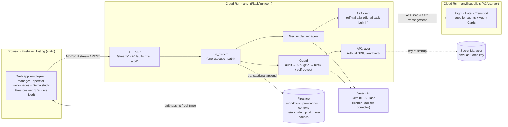
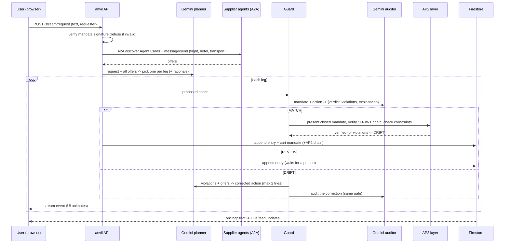
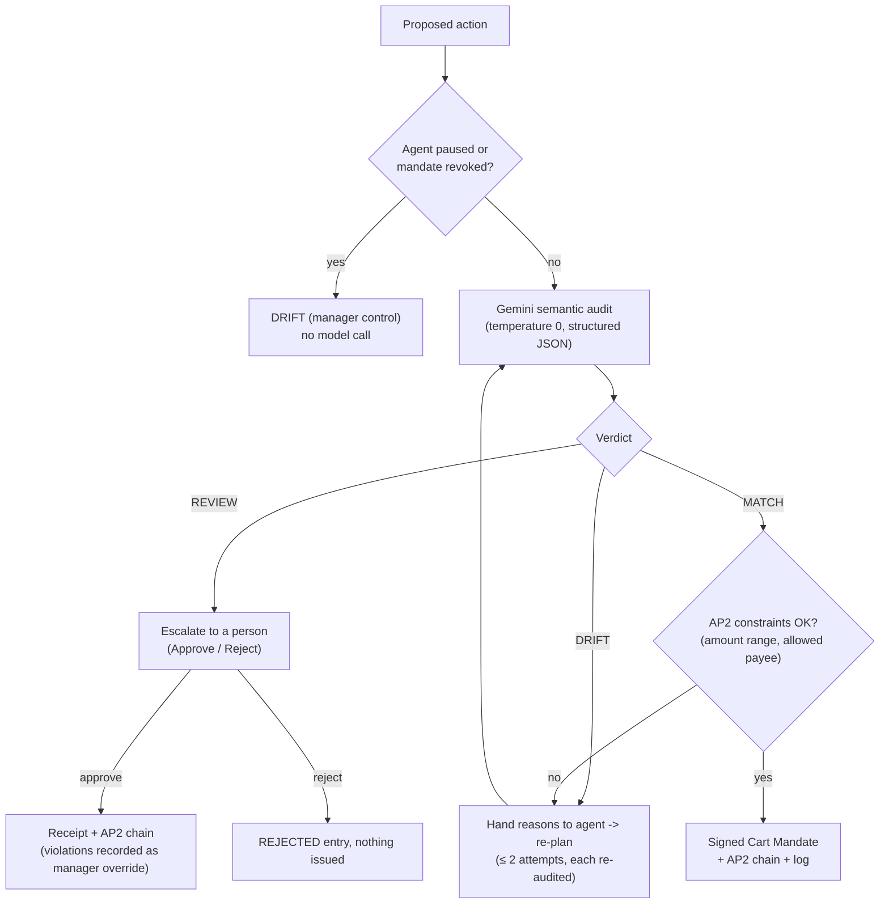

# 03 · Architecture overview and design flow

Diagrams are Mermaid (render on GitHub and in most Markdown viewers). Facts match the deployed system as of 2026-10-18.

## 1. The idea in one paragraph
A manager **signs a mandate** (what an agent may do). Autonomous agents propose actions. Before any money moves, Anvil asks **Gemini** whether the action honors the *intent* of that mandate (MATCH / REVIEW / DRIFT), applies **deterministic checks outside the model** (including Google's **AP2 SDK** constraints), blocks or escalates what drifts, hands the agent the exact reason so it can **self-correct**, and records every step in a **hash-chained, tamper-evident log** with signed receipts.

## 2. System architecture

**Why two Cloud Run services:** the supplier agents are a separate A2A server, so buyer↔supplier traffic is real network A2A (and an external client can call it — this is how we proved interop with Google's official A2A client).

## 3. One request, end to end (natural-language path)

## 4. The decision gate

Key property: **only `MATCH` (after the AP2 gate) or a human-approved `REVIEW` ever gets a receipt**, and that rule is plain code, not model output. If Gemini is unreachable after retries the run errors and nothing is approved. If the AP2 layer is unavailable (not configured / infra error) nothing is blocked and behavior is exactly pre-AP2, with the error recorded on the entry.

## 5. Data model (Firestore)

| Collection / doc | Contents |
|---|---|
| `mandates/mandate-001` | Signed Intent Mandate: `constraints` (destination, class, caps, preferred airlines, allowed suppliers, refundable_required…), `signature` (HMAC), issued/expiry, nonce |
| `provenance/*` | One entry per decision/control: `action`, `verdict`, `severity`, `violations`, `explanation`, `delegation[]` (manager → orchestrator → agent → supplier), `prev_hash`, `hash`, `cart_mandate`, `ap2{verified, violations, chain_sha256, chain_token, manager_override…}`, `counterfactual`, `telemetry` / `agent_telemetry` (tokens, latency, cost), `requester`, `origin` (`user`/`simulated`), `request`, `gate` |
| `controls/state` | `paused_until{agent→ts}`, `revoked_until`, `session_start` (pauses/revocations auto-expire) |
| `meta/chain_tip` | Latest hash; updated in the same transaction as every append |
| `meta/sim` | Simulation lease (`last`, `day`, `count`) |
| `meta/eval_latest`, `meta/eval_latest_software` | Cached scoreboards |
| `verdict_cache/*` | Last good verdict per (mandate, action, prompt, model) — fallback only |

## 6. Trust boundaries and keys
| Thing | Where it lives | Notes |
|---|---|---|
| Manager's AP2 signing key (ES256) | `~/.anvil/ap2-manager-key.jwk` on the manager's machine | **Never on the server.** Signs the open mandates once |
| Manager public key + signed open mandates | `data/ap2_open_mandates.json` (committed) | Public artifacts; used to verify every chain |
| Orchestrator AP2 key (ES256) | **Secret Manager** → env `ANVIL_AP2_ORCH_KEY` | Only private key on the server |
| HMAC key for Intent/Cart mandates | env `ANVIL_SIGNING_KEY` | ⚠ dev default in the current deployment |
| Firestore access | Rules: public read, **no client writes** | Browser can only read; the API writes |
| Audit chain | `hash = sha256(prev_hash + canonical(entry))` | Tamper-**evident**, not tamper-proof (DB writers could rebuild it) |

## 7. Design decisions and why
1. **Gemini advises, code decides.** The verdict is data; enforcement is deterministic. This is what makes a probabilistic model safe to put in a payment path.
2. **Stack two independent gates.** AP2 constraints (amount, payee) catch what can be expressed as rules; Gemini catches what needs judgment (class swap at an approved price, splits, hidden add-ons, manipulation). Measured, not assumed.
3. **Fail-safe, not fail-open, where it matters.** Model unavailable ⇒ nothing approved. Infrastructure optional layers (AP2, official A2A) degrade to the previous behavior without blocking, and say so.
4. **Don't trust the agent's text.** Free-text notes are untrusted data and carry no authority; the planner's rationale is kept *out* of the audited action.
5. **Corrections are re-audited.** The self-correction loop never bypasses enforcement.
6. **Stream everything.** Each step is written to the chain the moment it completes and streamed (NDJSON) so the UI is genuinely live; the Firestore listener drives the Live feed.
7. **One door to Gemini** (`anvil/gemini.py`): timeouts, retries, telemetry — so cost and latency are reported, not guessed.
8. **Single-file static UI**, no build step: deploys in seconds, easy to hand over.

## 8. Concurrency, scaling and failure modes
- **Concurrency:** gunicorn 8 threads, Cloud Run concurrency 8, min 1 / max 10 instances. Tested: 8 simultaneous runs finish in ~34 s (one ≈ 20 s) with correct verdicts and an intact chain.
- **Chain integrity under load:** appends are Firestore transactions on `meta/chain_tip` (O(1) reads, no fork), serialized per instance with a timeout.
- **Simulation:** browser-driven; a global Firestore lease allows one tick per ≥20 s and a daily cap, so N viewers cause one request.
- **Abuse:** per-IP rate limit (120/min) on Gemini-calling endpoints; recommend a GCP billing budget alert.
- **Failure behavior:** Gemini 429/5xx/stall ⇒ retries with backoff, then error (no approval); official A2A failure ⇒ built-in client for that call; AP2 failure ⇒ recorded, not blocking; Firestore listener drop ⇒ REST fallback in the UI.
- **Known scaling limits:** one global chain (~1 write/s/doc guideline; per-tenant chains remove it), sequential legs per run, metrics re-read up to 500 entries per call.

## 9. API surface (all on the `anvil` service)
| Endpoint | Purpose |
|---|---|
| `POST /stream/request`, `POST /stream/scenario` | Streamed runs (NL via Gemini agent; scripted scenarios). Body may include `requester`, `enforce:false` |
| `POST /v1/authorize` | Integration endpoint: one action → decision, reason, counterfactual, AP2 chain, receipt |
| `POST /approve/<id>`, `/reject/<id>` | Human re-consent on a REVIEW |
| `POST /api/control` | pause/resume agent, revoke/restore mandate, new session |
| `POST /api/sim/tick` | One leased simulated request |
| `GET /api/metrics`, `/api/impact`, `/api/evidence` | Governance numbers; prevented spend; audit pack |
| `GET /api/ap2`, `/api/ap2/verify/<id>`, `/api/a2a` | AP2 status and independent re-verification; A2A client mode |
| `GET /api/eval[?domain=software&refresh=1&repeats=N]` | Scoreboards |
| `GET /api/mandate`, `/api/mandate/tampered`, `/api/verify`, `/api/verify/tamper`, `/api/provenance` | Signature checks, chain verification, the log |

Supplier service (`anvil-suppliers`): `GET /<kind>/.well-known/agent-card.json`, `POST /<kind>/a2a` (JSON-RPC `message/send`) for `flight`, `hotel`, `transport`.

## 10. Deployment topology and commands
- Project `dazzling-lodge-511607-m0`, region `us-central1`.
- Deploy API: `gcloud run deploy anvil --source . --region us-central1 --allow-unauthenticated` (env and the secret persist across deploys).
- Deploy suppliers: `gcloud run deploy anvil-suppliers --source suppliers --region us-central1 --allow-unauthenticated`.
- Deploy UI: `firebase deploy --only hosting`.
- Verify after any change: `python scripts/smoke_live.py` (and the two local test modes).
- Rollback AP2: remove `ANVIL_AP2_ORCH_KEY` (`gcloud run services update anvil --region us-central1 --remove-secrets ANVIL_AP2_ORCH_KEY`). Rollback A2A client: set `ANVIL_A2A_OFFICIAL=0`. Rollback a revision: `gcloud run services update-traffic anvil --region us-central1 --to-revisions <rev>=100`.
